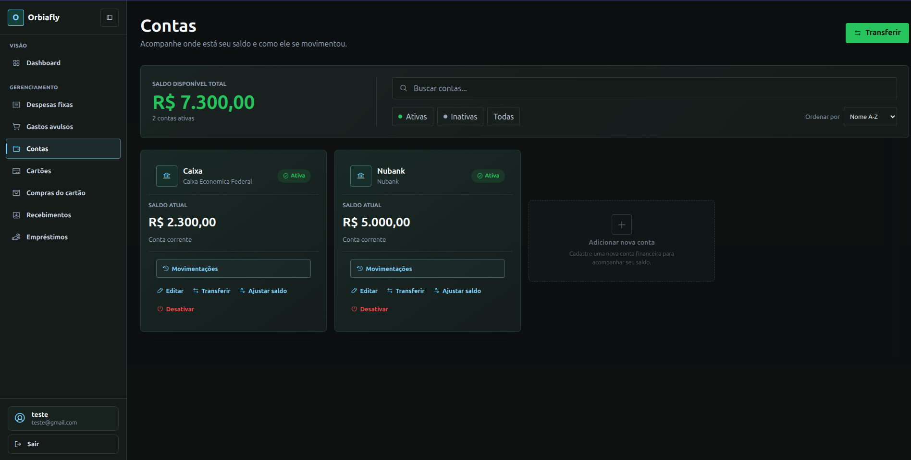
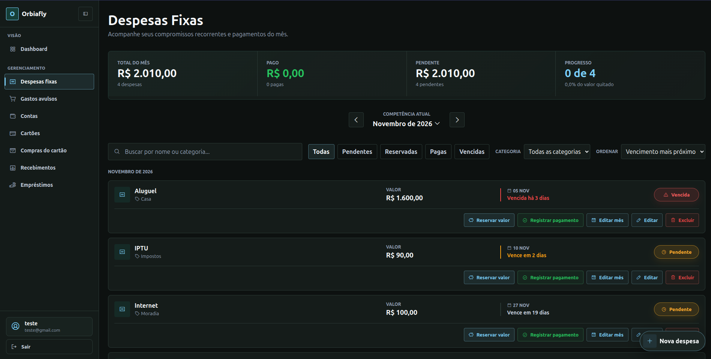
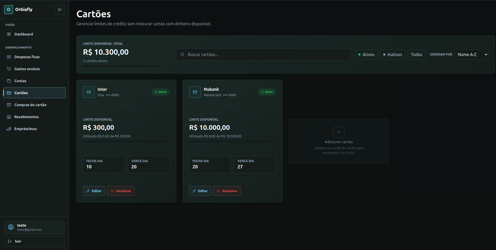
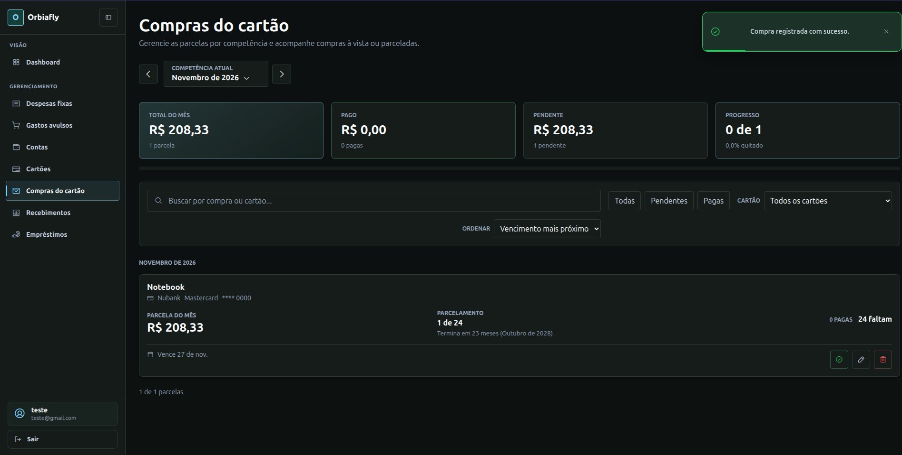
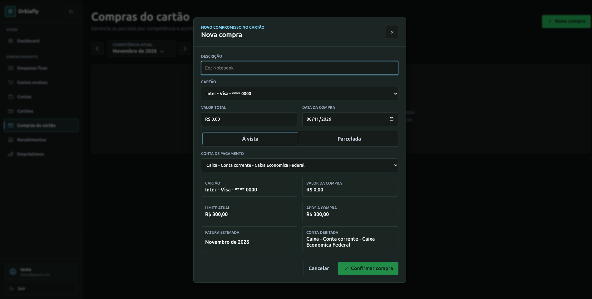
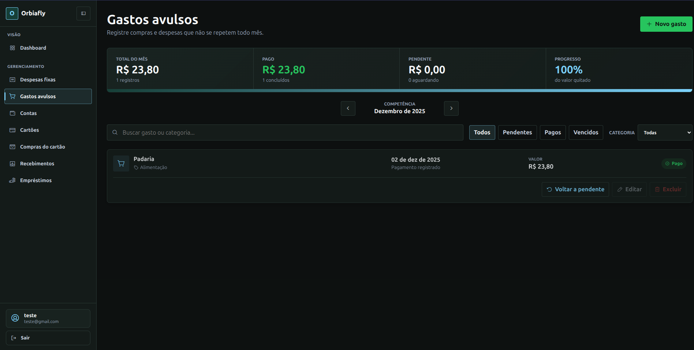
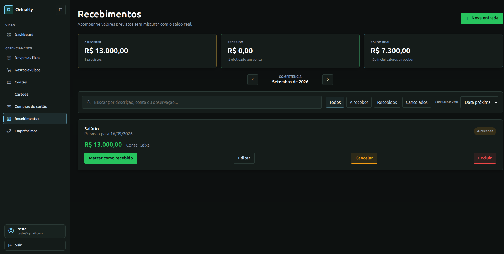
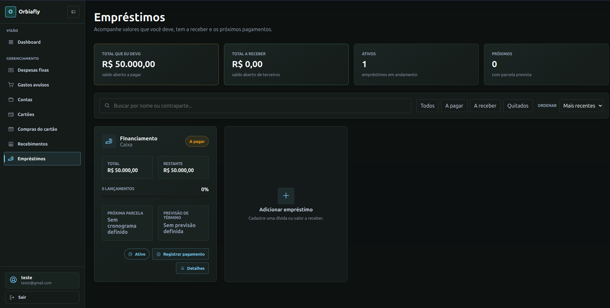
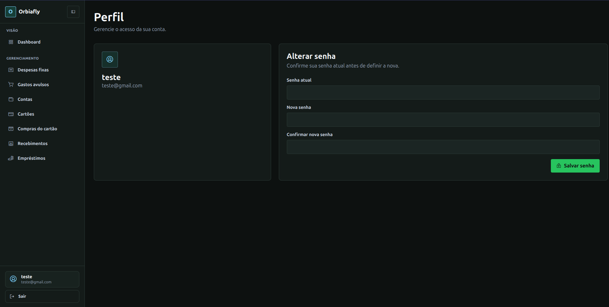

# Orbiafly — Frontend

**Interface de gestão financeira pessoal para execução em ambiente próprio.**

O **Orbiafly** é uma aplicação que utilizo para acompanhar minhas finanças em um único lugar, separando **saldo em contas**, **limite de cartões**, **despesas**, **recebimentos** e **compromissos financeiros**. O foco é oferecer uma visão clara das movimentações e das obrigações, sem confundir valores previstos com dinheiro efetivamente disponível.

O frontend é desenvolvido em **Angular, TypeScript e SCSS** e se comunica com uma API própria.

> **Projeto pessoal em evolução contínua.** Não existe uma instância pública de demonstração. O uso é voltado a uma instalação própria (*self-hosted*).

## Repositórios

| Componente | Repositório |
| --- | --- |
| **Frontend — este repositório** | [orbiafly-front-end](https://github.com/cesarrafaeljunior/orbiafly-front-end) |
| **Backend / API** | [orbiafly-back-end](https://github.com/cesarrafaeljunior/orbiafly-back-end) |

## Visão geral da interface



A interface utiliza um layout escuro, navegação lateral e módulos independentes para acompanhar diferentes aspectos do orçamento pessoal. As capturas apresentam exemplos da interface; antes de publicá-las, confirme que nenhum dado financeiro ou pessoal real esteja visível.

## Funcionalidades

| Módulo | Recursos apresentados na interface |
| --- | --- |
| **Contas** | Cadastro e consulta de contas, saldo disponível, movimentações, transferência, ajuste de saldo e ativação/inativação. |
| **Cartões** | Cadastro de cartões, limite disponível e utilizado, datas de fechamento e vencimento, busca e filtros por situação. |
| **Compras do cartão** | Compras à vista ou parceladas, vínculo com cartão, acompanhamento por competência e situação das parcelas. |
| **Despesas fixas** | Compromissos recorrentes, visão mensal, vencimentos, reserva de valores, registro de pagamentos e estados de acompanhamento. |
| **Gastos avulsos** | Despesas não recorrentes, categorização, consulta por competência e controle de pagamentos. |
| **Recebimentos** | Previsões de entrada, acompanhamento do que foi efetivamente recebido e distinção entre valores previstos e saldo real. |
| **Empréstimos** | Acompanhamento de valores a pagar e a receber, saldos em aberto e registro de pagamentos. |
| **Perfil** | Informações da conta e interface para alteração de senha. |

A navegação também inclui uma área de **Dashboard**, não detalhada nesta documentação por falta de uma captura específica.

### Regras de apresentação financeira

- **Saldo bancário** e **limite de crédito** são conceitos distintos e não devem ser somados como dinheiro disponível.
- **Recebimentos previstos** não aumentam o saldo real antes de serem efetivados.
- **Compras parceladas** são acompanhadas por competência e cartão.
- **Despesas recorrentes** e **gastos avulsos** possuem fluxos separados de acompanhamento.

Essas distinções orientam a experiência do usuário e a leitura dos indicadores apresentados na interface.

## Capturas de tela

### Despesas fixas



### Cartões



### Compras do cartão



<details>
<summary>Ver mais telas do Orbiafly</summary>

#### Cadastro de compra



#### Gastos avulsos



#### Recebimentos



#### Empréstimos



#### Perfil



</details>

As imagens devem ficar em `docs/screenshots/` neste repositório. Os arquivos estão incluídos no pacote de documentação fornecido com este README.

## Tecnologias

- **Angular** — aplicação web e organização de interface.
- **TypeScript** — implementação da aplicação.
- **SCSS** — estilos e identidade visual.
- **API HTTP própria** — integração com as regras de negócio e persistência implementadas no [backend](https://github.com/cesarrafaeljunior/orbiafly-back-end).

> Versões exatas e bibliotecas adicionais devem ser consultadas no `package.json` do repositório.

## Execução local

### Pré-requisitos

- Node.js e npm em versões compatíveis com a versão do Angular declarada pelo projeto.
- [Backend do Orbiafly](https://github.com/cesarrafaeljunior/orbiafly-back-end) configurado e em execução.

### 1. Clonar e instalar

```bash
git clone https://github.com/cesarrafaeljunior/orbiafly-front-end.git
cd orbiafly-front-end
npm install
```

### 2. Configurar a conexão com a API

Identifique a configuração da URL base da API usada pelos serviços HTTP da aplicação e ajuste-a para o endereço em que o backend estiver em execução.

A localização exata dessa configuração depende dos arquivos atuais do repositório; confirme se ela está em arquivos de ambiente, configuração de desenvolvimento ou outro ponto centralizado antes de publicar instruções mais específicas.

### 3. Iniciar em desenvolvimento

Em um workspace Angular com CLI disponível:

```bash
npx ng serve
```

Por padrão, o Angular CLI disponibiliza a aplicação em `http://localhost:4200`, salvo configuração diferente no projeto. Se o `package.json` definir um script próprio, utilize o comando documentado nele.

### 4. Gerar build

```bash
npx ng build
```

A saída do build segue a configuração definida no workspace Angular.

## Organização e integração

O frontend é responsável pela navegação, apresentação dos dados, formulários, filtros e feedback das operações. As regras de negócio e a persistência devem permanecer centralizadas na API, evitando que a interface seja a fonte de verdade dos saldos e compromissos.

Para configurar o banco de dados, executar os serviços da API e entender os requisitos do servidor, consulte o **[README do backend](https://github.com/cesarrafaeljunior/orbiafly-back-end#readme)**.

## Privacidade e publicação

O projeto lida com informações financeiras e, por isso, uma instalação de terceiros deve usar **seu próprio banco de dados e suas próprias credenciais**. Nunca publique arquivos de ambiente, tokens, dados pessoais ou backups reais.

As capturas de tela deste README devem ser revisadas antes da publicação para garantir que utilizem somente dados de demonstração.

> Disponibilizar um repositório publicamente não equivale, por si só, a conceder uma licença de uso ou distribuição. Consulte o arquivo `LICENSE`, caso exista, para conhecer os termos aplicáveis.

---

**Autor:** [César Rafael](https://github.com/cesarrafaeljunior)  
**API:** [orbiafly-back-end](https://github.com/cesarrafaeljunior/orbiafly-back-end)
